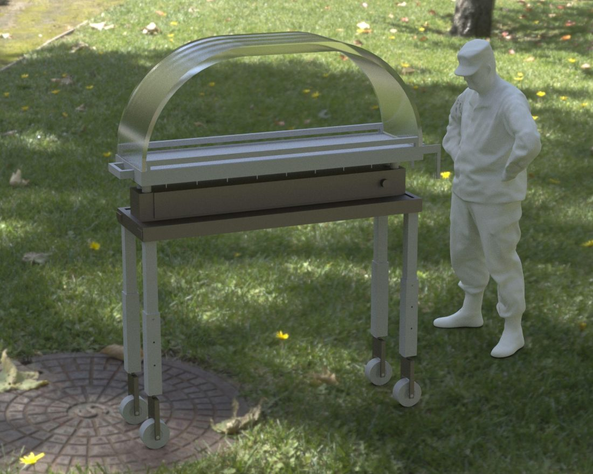

# Dynamic Rescuer: an all-terrain patient carrier

**Design project** · MEC325 Introduction to Engineering Design · Ryerson University · Fall 2023 
**Team 0804:** Hamzah Chamas, Dante Rieger, Henry Hy, Michael Garcia, Aser Shiferaw, Qamber Rizvi

## The brief

A multinational NGO working with the World Health Organization asked for a rethink of how incapacitated people are moved. Traditional stretchers are built for flat ground and fail in rubble, mud, snow and rough trails. The system had to work for **urban disasters** and **wilderness injuries** while staying comparable to existing solutions in durability and cost.

## Process

1. Situation scan of goals, environment, competition, users (paramedics) and co-users (patients)
2. Six personas and situated use cases to surface human-factors needs
3. Situational and internal engineering requirements (for example, a bed assembly of no more than 14 kg dry weight)
4. Six initial concepts combined through a morphological chart into one integrated concept, with a system diagram and interface matrix
5. Cambridge Exclusion Calculator analysis to reduce the share of users excluded on strength and dexterity
6. Sketches, a full set of CAD drawings and a design change record across three design loops

## The design

- **Roll it or carry it:** a standalone bed clips onto a wheeled steel frame and lifts off for hand-carrying where wheels can't go
- **Fits every operator:** height-adjustable legs and modular steering handles
- **Brakes in the grip:** a trigger on each handle applies two brake pads per wheel mount
- **Storage:** a 73.1 L compartment fits a standard Canadian EMS trauma kit (about 42.8 L)
- **Materials:** steel frame (585 MPa tensile), polyethylene bed and legs, natural rubber handles, lights on user-replaceable lithium batteries rated −20 to 60 °C
- **Patient-centred:** the full canopy was redesigned as a roof only so patients with cognitive disorders don't feel enclosed

## My role

- Research and analysis behind the brief, users and requirements
- Detailed 3D model in SolidWorks
- Documenting the product development process in the design report
- The team's design plan and timeline

Full write-up: [danterieger.github.io/projects/dynamic-rescuer.html](https://danterieger.github.io/projects/dynamic-rescuer.html)
