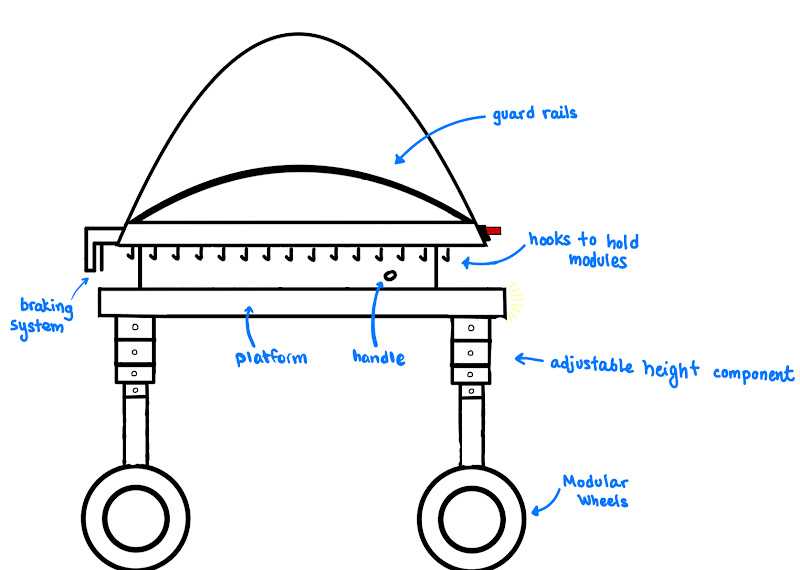
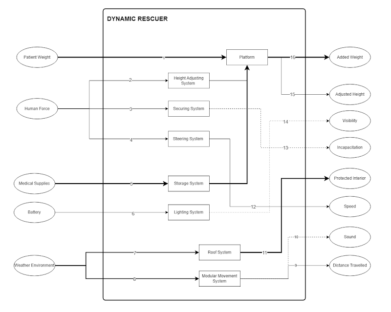
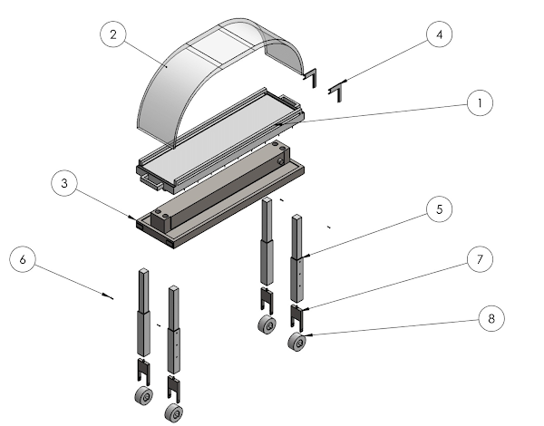

# Dynamic Rescuer: an all-terrain patient carrier

**Design project** · MEC325 Introduction to Engineering Design · Ryerson University · Fall 2023 
**Team 0804:** Hamzah Chamas, Dante Rieger, Henry Hy, Michael Garcia, Aser Shiferaw, Qamber Rizvi 
**Tools:** SolidWorks · Cambridge Exclusion Calculator · morphological charts · systems analysis

## The brief

A multinational NGO working with the World Health Organization asked for a rethink of how incapacitated people are moved. Traditional stretchers are built for flat ground and fail in rubble, mud, snow and rough trails. The system had to work for **urban disasters** and **wilderness injuries** while staying comparable to existing solutions in durability and cost.

## Process

Three design loops (six individual concepts, six refined concepts, one integrated design), with every change logged in a design change record.

1. **Personas and use cases.** Six personas (three paramedics, three patients) placed in realistic rescues: a car crash the ambulance can't reach, a stroke patient on an aircraft staircase, a building collapse, a flash flood, a house fire, and a paralyzed snowboarder in deep snow.
2. **Requirements.** About 30 situational and internal requirements, each sourced. Highlights:

| Requirement | Target | Why |
|---|---|---|
| Patient load | Up to 159 kg | Standard limit of reference stretchers |
| Envelope | 2134 × 610 mm | Fits ambulance-ready elevators |
| Working height | 64.3 to 119.0 cm | 5th percentile female knuckle to 95th percentile male elbow height |
| Empty weight | 50 kg max, bed 14 kg | Paramedics are certified to carry 50 kg on stairs |
| Hold on a slope | 30° grade, wheel friction 0.58 to 1.00 | tan 30° = 0.577 |
| Brake trigger | 15 to 25 mm from the grip | Room for gloved fingers |
| Terrain | 46 cm water, 20 cm snow, 5 km range | Flood depths, snowfall data, lost-hiker distance |
| Environment | −45 to 56.7 °C, 40 to 95% RH | Coldest inhabited to hottest recorded |
| Lighting and noise | 200 to 500 lux, 82 dB max | Visibility without glare; sound-sensitive patients |
| Storage | At least 42.7 L | Standard EMT trauma kit |

3. **Concept integration.** A morphological chart, analogical design (military aircraft canopy, landing-gear wheels), SCAMPER (folding frame replaced by adjustable legs) and design by attribute (modular steering handles).

4. **Systems analysis.** A subsystem identification matrix and a system diagram tracing inputs (patient weight, human force, supplies, battery, weather) to outputs, including bad outputs like added weight and noise.

5. **Inclusive design check.** Cambridge Exclusion Calculator analysis of the full setup, use and put-away sequence.

## The design

- **Roll it or carry it:** a polyethylene bed slides onto the steel frame on circular rods and lifts off by built-in handles where wheels can't go
- **Fits every operator:** telescoping legs lock with a pin at three heights from 600 to 1170 mm; modular steering handles mount on the frame or the bed
- **Brakes in the grip:** a trigger in front of each grip applies two brake pads per wheel mount
- **Restraints:** off-the-shelf Ferno 430 Series straps (406 to 2743 mm) with quick release, as Ontario ambulance standards require
- **Canopy:** 800 mm clear acrylic, detaches without tools; redesigned as a roof only so claustrophobic patients don't feel enclosed
- **Storage:** a 73.1 L compartment fits a standard Canadian EMS trauma kit (about 42.8 L), plus hooks for add-on modules
- **Materials:** AISI 1045 steel frame (585 MPa tensile), polyethylene bed and legs, natural rubber handles and treads, LED lights on user-replaceable 9 V lithium-ion batteries rated −20 to 60 °C

| Item | Part | Description | Qty |
|---|---|---|---|
| 1 | Bed | Custom, polyethylene | 1 |
| 2 | Canopy | Custom, acrylic | 1 |
| 3 | Frame | Custom, AISI 1045 steel | 1 |
| 4 | Handle | Custom, natural rubber | 2 |
| 5 | Leg | Custom, polyethylene | 4 |
| 6 | Button head hex drive screw | McMaster-Carr 92095A294 | 4 |
| 7 | Wheel cover | Custom, AISI 1045 steel | 4 |
| 8 | Wheel | Custom, natural rubber | 4 |

## Trade-offs

- **Wheels over swappable attachments:** skis or tracks would cost time and invite fastening mistakes under pressure; soft rubber casters also absorb shock, removing the need for suspension
- **Off-the-shelf where it already works:** restraints, screws and comfort pillows were bought, not designed
- **Fewer fasteners** so a stressed operator can assemble it quickly and correctly

## Who it excludes

| Demand | Hardest step | Excluded |
|---|---|---|
| Vision | Attaching steering handles at the right height | 0.9% |
| Concentration and memory | Fitting modules and setting leg height | 4.0% |
| Strength and dexterity (non-dominant) | Loading and restraining the patient | 5.2% |
| Strength and dexterity (dominant) | Carrying the loaded bed | 5.9% |
| Hearing | Steering while talking in a noisy scene | 6.4% |
| Walking and mobility | Steering long distances over rough ground | 11.6% |

Strength and dexterity exclusion fell from at least 9% in most loop 2 concepts to 5.9%.

## What we had to fix along the way

- **Loop 1:** underspecified brakes, sway from missing suspension, no patient restraints, controls that looked too similar, hard-to-read indicators in poor light
- **Loop 2:** a wheel design over the 82 dB limit, a full canopy that excluded claustrophobic patients, a base that left the patient's legs hanging

## Where it fell short

- 33 mm too wide and 121 mm too long for the 2134 × 610 mm envelope
- A CAD modelling error gave wrong mass properties, so the 50 kg empty weight wasn't confirmed from the model
- Fixed casters and pin-set legs limit deep snow and floodwater capability
- Setting the pins and reaching the under-bed storage both require bending down

Next iteration: shrink the frame into the envelope, rebuild the model with correct materials to verify weight, and replace the pins with lever-actuated height adjustment from handle height.

## Conclusion

The Dynamic Rescuer meets the brief's core goal: one system that rolls where it can and is carried where it can't, sized for the full range of paramedics and built around the patient. Its biggest decisions (adjustable height, modular steering handles and a roof-only canopy) came from the personas and exclusion analysis rather than geometry alone.

## My role

- Research and analysis behind the brief, users and requirements
- Detailed 3D model in SolidWorks
- The paramedic persona and the deep-snow snowboarder use case
- Documenting the product development process in the design report
- The team's design plan and timeline

Case study on my website: [danterieger.github.io/projects/dynamic-rescuer.html](https://danterieger.github.io/projects/dynamic-rescuer.html)
