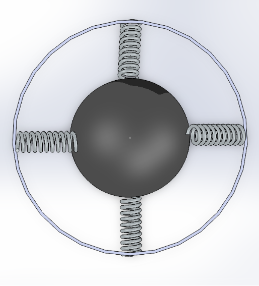
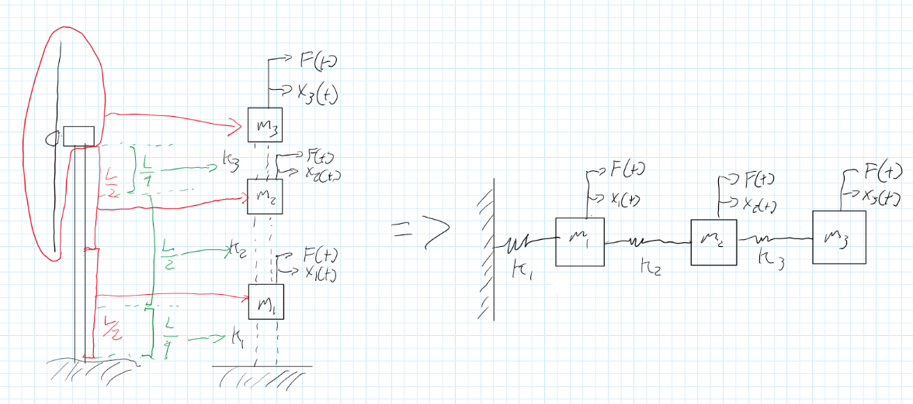
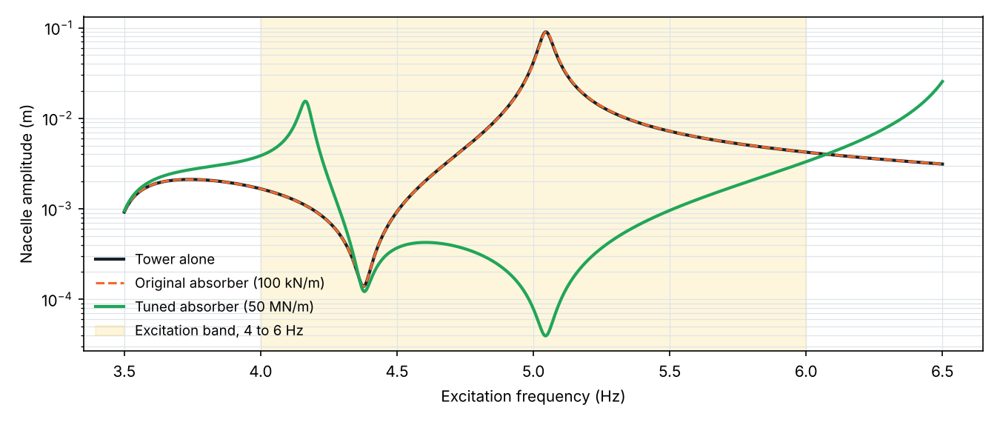

# Wind turbine tower vibration absorber

**Team design project** · Winter 2024 
**Team:** Jonah Roukema, Dante Rieger, Nathan Abdul, Kavin Bharathi, Noah Gordon 
**Tools:** Python (NumPy, Matplotlib) · SolidWorks

A vibration absorber for an 85 m wind turbine tower: a lumped-mass model in Python, a spring-and-EPDM design in SolidWorks, and a later re-check that found and fixed a simulation bug.

## The brief

Larger rotors make turbines more efficient but load the tower harder. Design a vibration-damping system for an 85 m, 4 m diameter steel tower with a ~10,000 kg generator on top that:

- controls a 500 kN wind excitation between 4 and 6 Hz
- survives a 110 km/h gust lasting 0.5 s
- fits in the 5 × 5 × 5 m space at the top of the tower
- is durable, quiet, safe, maintainable and reasonably priced

## My role

- The mathematical model of the tower and the Python simulations
- The SolidWorks model of the absorber
- Re-checking the simulation for this write-up and correcting the analysis (`recheck.py`)

## Model

The A36 steel tower (4 m outer, 3.9 m inner diameter) is reduced to two 207,000 kg tower masses and a 129,144 kg nacelle mass, joined by springs of 78.3, 9.79 and 78.3 MN/m. Wind is a 500 kN harmonic force on each mass; the gust is modelled as a step change in initial velocity.

Natural frequencies: **0.80, 3.29 and 5.05 Hz**. The 5.05 Hz mode is inside the 4 to 6 Hz wind band, so the tower needs an absorber.

## Design

A morphological chart covered three subsystems: damping mechanism, adjustment system and absorber material. The first design (hard rubber damper, tension springs, polyurethane) was revised to:

- **compression springs**, because the tower's motion loads the absorber mainly in compression
- **no friction damper**, to avoid heat next to the generator
- **EPDM instead of polyurethane**: cheaper, longer-lived, and weather, ageing and abrasion resistant

The final design holds a spherical absorber mass in a ring frame on four compression springs with EPDM dampers.

## Re-checking the simulation

The original report claimed the absorber cut tower vibration from ~0.2 m to ~0.03 m. Re-running the team's code showed that result came from a bug: `np.linalg.eig` returns eigenvalues unsorted, and the code paired natural frequencies with the wrong mode shapes. With that fixed (`recheck.py` solves the steady-state response directly, so no pairing is needed):

| Absorber | Absorber frequency | Effect in the 4 to 6 Hz band |
|---|---|---|
| Original: 50,000 kg on 100 kN/m | ~0.23 Hz | Essentially none |
| Tuned: 50,000 kg on ~50 MN/m | 5.05 Hz | 5 Hz peak removed; worst case ~9 cm → ~1.5 cm (1% loss factor assumed) |

A tuned absorber splits one resonance into two; the new peak near 4.2 Hz is still in band, so a real design needs absorber damping (the EPDM's job) to flatten both.

Note: the original code attached the absorber to the middle tower mass; `recheck.py` attaches it at the nacelle, where the design actually sits.

## What we'd change

- Tune the absorber to the resonance first, then size the springs
- Include damping in the model
- Check simulations against a simple hand or steady-state calculation before trusting a big improvement
- Use measured EPDM stiffness and damping data for the material choice

Case study on my website: [danterieger.github.io/projects/wind-turbine-absorber.html](https://danterieger.github.io/projects/wind-turbine-absorber.html)
