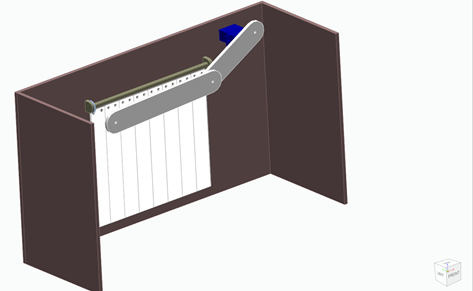
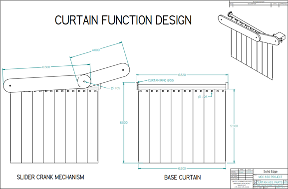
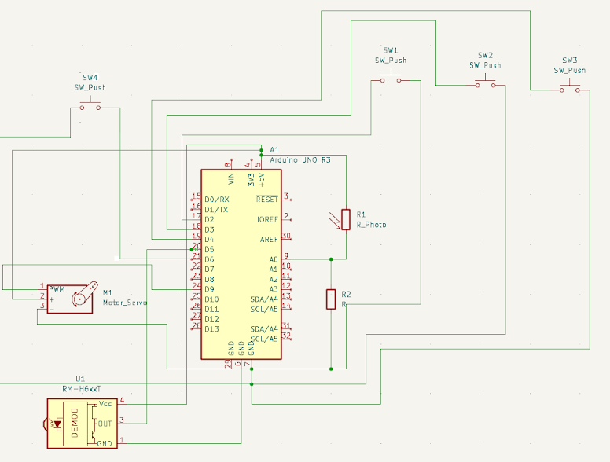

# Smart curtain: light-controlled window automation

**Team design project** · MEC 830 Mechatronics Systems Design · Fall 2025 
**Group 02:** Nitin Mahay, Joshua Jeyasanker, Dante Rieger, Elti Tabaku 
**Tools:** Arduino Uno (C++) · TinkerCAD · KiCad · Solid Edge

An Arduino reads a light sensor and drives a servo and slider-crank to open, half-open or close a curtain on its own, with manual and remote modes that override the automation.

## The brief

Turn our Phase 1 control logic into a working hardware prototype: a low-cost curtain that opens in daylight and closes at night by itself, while still letting the user take over with a button or a remote. Built from an Arduino Uno kit and inexpensive materials, and it had to work consistently.

## My role

- Proposed one of the team's four design concepts (photoresistor sensing, push-button control, a slider design and a popsicle-stick curtain rod), the combination the final prototype was built on
- Worked with the team on mechanism selection, testing and the final report

## How we designed it

1. **Four concepts, one morphological chart.** All used an Arduino Uno, a servo and an IR remote; three used a photoresistor, push buttons and a slider.
2. **Three mechanisms prototyped.** A roll-up shaft, a string pulley and a slider-crank. Only the slider-crank opened and closed the curtain consistently.
3. **Linkage sized** at a 4 in crank and a 6.5 in slider link, through calculation and trial and error:

| Servo angle | Slider reach | Curtain |
|---|---|---|
| 0° | 6.5 in | Closed |
| 90° | Partway | Half open |
| 180° | 0 in (links overlap) | Fully open |

## Electronics

- Photoresistor voltage divider on A0 (0 to 1023), the only analog signal
- Open, close, half-open and mode buttons on D2, D3, D6 and D4 with internal pull-ups and software debouncing
- Remote input on D5; IR receiver module on 5 V, ground and one digital pin
- Servo on PWM pin D9; everything powered from the Arduino's 5 V USB supply

## Control logic

A three-mode state machine, cycled by the mode button:

| Mode | How it decides |
|---|---|
| Automatic | Above 700: fully open. 500 to 700: half open. Below 300: closed. Between 300 and 500 it holds its last position. |
| Manual | Open, half and close buttons set the position directly. |
| Remote | The remote button cycles closed, half, open. Serial commands O, H, C, T and S open, half-open, close, cycle or report status. |

The servo moves 2° at a time with a 15 ms pause, so the curtain glides instead of snapping and the motor and cardboard linkage are spared shock loads.

## Build

Cardboard frame and links, a popsicle-stick rod, zip-tie curtain rings, and a front panel that hides the mechanism.

## Results and what we'd change

The curtain moved smoothly between all three positions and followed the light thresholds and user inputs in testing.

- Remote control was simulated with a button and serial commands; a real IR receiver and remote come next
- 3D-printed links and frame instead of cardboard
- Tune the 300 / 500 / 700 thresholds against real window light
- LED indicators for the current mode

Case study on my website: [danterieger.github.io/projects/smart-curtain.html](https://danterieger.github.io/projects/smart-curtain.html)
