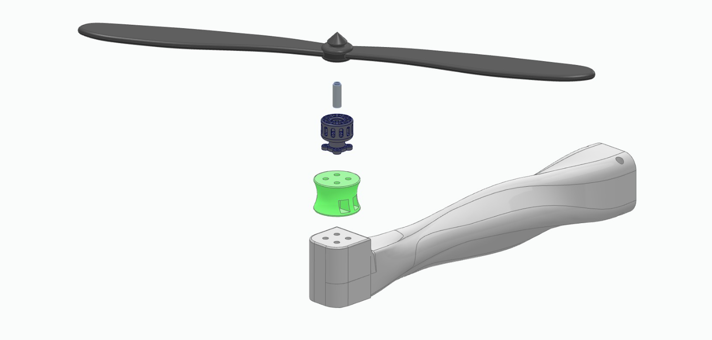
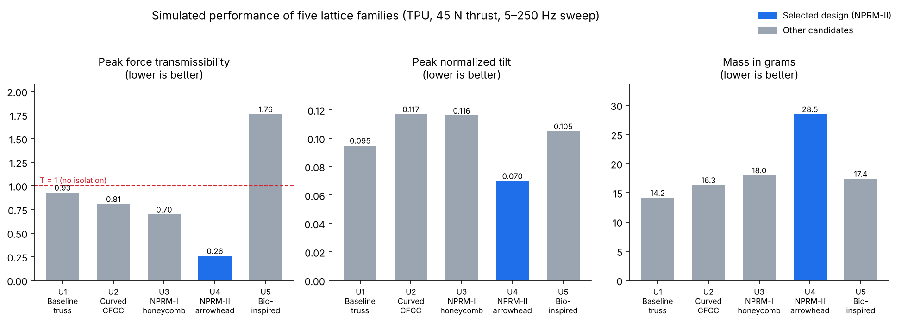
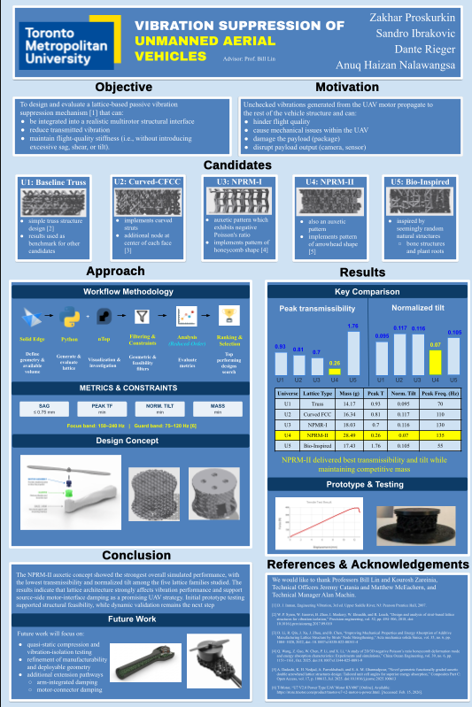

# Vibration Suppression of UAVs: Lattice-Based Motor Damper

**Capstone project** · MEC 825 Mechanical Design · Toronto Metropolitan University · Winter 2026 (January to April) 
**Team:** Zakhar Proskurkin (lead), Sandro Ibrakovic, Dante Rieger, Anuq Haizan Nalawangsa · **Supervisor:** Prof. Bill Lin

## The problem

Drone motors create broadband vibration from rotor imbalance, aerodynamic loading and drivetrain dynamics. That vibration travels through the frame into the payload, causing blurry camera footage, noisy sensor data and mechanical wear. Most fixes treat the symptom (isolating the payload or stiffening the frame). We went to the **source**: a passive damper that sits between the motor and the arm.

**Design conditions:** 5–250 Hz operating range, 45 N maximum thrust, and a damper that must bolt between an existing motor and arm (fixed height and volume).

## Approach

Exploring hundreds of lattice variations in conventional CAD/FEA wasn't realistic, so we built a computational design workflow:

1. **Model the geometry mathematically** for five lattice families (node positions, strut shapes, pitch rules)
2. **Generate many configurations** of each family in Python within the volume and mounting constraints
3. **Filter** out designs that fail clearance, connectivity or manufacturability checks
4. **Simulate** each survivor as a beam-and-joint model in TPU: static sag under 45 N, force transmissibility and tilt across a harmonic sweep
5. **Rank** candidates on transmissibility, tilt, sag and mass, then bring the best into **nTop** to check feasibility
6. **Prototype and test** a 3D-printed TPU damper

**Tools:** Solid Edge · Python · nTop · TPU additive manufacturing · tensile testing

### The five lattice families

| ID | Family | Idea |
|---|---|---|
| U1 | Baseline truss | Simple truss lattice, used as the benchmark |
| U2 | Curved CFCC | Curved, hourglass-shaped struts for better load distribution |
| U3 | NPRM-I (honeycomb) | Auxetic (negative Poisson's ratio) hexagon pattern for energy absorption |
| U4 | NPRM-II (arrowhead) | Auxetic arrowhead pattern |
| U5 | Bio-inspired | Randomized, root/bone-like strut growth with weak struts pruned |

## Results

| Lattice | Mass (g) | Peak transmissibility | Peak normalized tilt | Peak frequency (Hz) |
|---|---|---|---|---|
| U1 Baseline truss | **14.17** | 0.93 | 0.095 | 70 |
| U2 Curved CFCC | 16.34 | 0.81 | 0.117 | 110 |
| U3 NPRM-I | 18.03 | 0.70 | 0.116 | 130 |
| **U4 NPRM-II** | 28.49 | **0.26** | **0.070** | 135 |
| U5 Bio-inspired | 17.43 | 1.76 | 0.105 | 55 |

- **NPRM-II (auxetic arrowhead) performed best overall.** It transmitted only about a quarter of the input force at its peak and stayed the most stable, at the cost of being the heaviest design.
- Static sag ranged from **0.17 mm** (honeycomb) to **0.75 mm** (baseline truss), all within the 0.75 mm limit.
- The bio-inspired lattice **amplified** vibration (transmissibility above 1), a useful negative result: random structure didn't help here.
- **Physical test:** a 3D-printed TPU baseline-lattice prototype withstood **383 N** in tensile testing before deforming, a **safety factor of about 8.5** over the 45 N thrust load.

**Takeaway:** lattice architecture strongly drives dynamic behaviour, and auxetic patterns are a promising route to source-side vibration control in UAVs.

## Limitations and next steps

Being upfront about what this project did and didn't prove:
- Vibration results are **simulated**. Only one physical test (tensile, on the baseline lattice) fit in the semester, so vibration attenuation hasn't been measured on hardware yet.
- Next: print and test NPRM-II with quasi-static compression and dedicated vibration-isolation experiments, reduce its mass, and improve the transfer from Python to nTop.

## My contributions

- Lattice geometric modelling and design in **nTop**, including the lattice damper variants (square honeycomb, simple cubic, re-entrant honeycomb, face-centred cubic)
- Rendering of the motor–damper–arm assembly for the poster
- Dynamic simulation support and validation strategy: comparison metrics and interpreting simulation results
- Physical prototyping and tensile testing
- Project coordination across the four-person team

## Poster

## Full design files

The full nTop files, CAD and high-resolution STL models (about 170–300 MB each) are too large for GitHub and are kept in the team's project drive. They're available on request: see the [case study on my website](https://danterieger.github.io/projects/uav-vibration-damper.html), [connect on LinkedIn](https://www.linkedin.com/in/dante-rieger-8823922aa/) or email dante.rieger@gmail.com.

## Acknowledgements

Prof. Bill Lin (supervisor); Jeremy Catania and Matthew McEachern (technical officers, additive manufacturing); Prof. Kourosh Zareinia (lab equipment and materials). Poster and conference paper were written jointly by the team.
